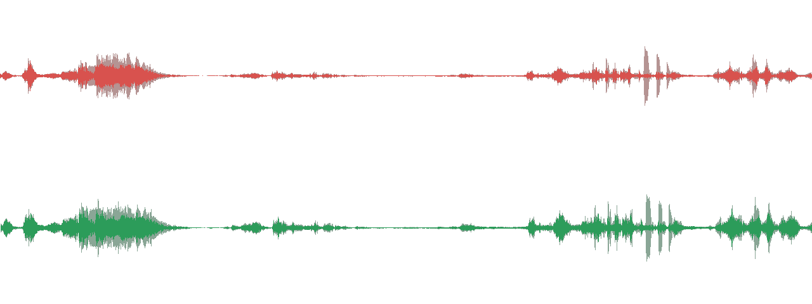

# soundcheck

**Your AI video sounds AI. Here are the 7 tells - and the fix.**

`48/100 -> 100/100`, measured on a shipped test fixture, verified with an independent meter.



```bash
npx skills add liuchong110/soundcheck
python scripts/soundcheck.py fix clip.mp4 --target youtube   # video in, video out
python scripts/soundcheck.py demo          # no assets needed
python scripts/verify.py                   # 19/19 self-test
```

## The problem

AI video pipelines got good at pictures and stayed bad at sound:

- TTS takes are rendered separately and glued together at **different levels**
- the music bed never **ducks** under the voice
- the mix is pushed into the ceiling to sound "loud" and **clips**
- the synthetic voice keeps its **6-10 kHz hiss** and **100-300 Hz boom**

None of that is taste. It is measurable, and it is fixable.

## What it does

```
$ python scripts/soundcheck.py demo

soundcheck - target youtube (streaming)
  duration 9.0s  48000 Hz  2 ch

  loudness         -6.9   target -14.0    FAIL
  true_peak         0.7   target -1.0     FAIL
  sibilance        0.72   target 0.45     FAIL
  mud              0.71   target 0.4      FAIL
  drift             2.7   target 3.0      ok
  noise_floor       n/a   target -45.0    ok    (no quiet passage)
  phase             1.0   target 0.2      ok

  SCORE 48/100 - sounds AI
```

```
$ python scripts/soundcheck.py fix demo_ai_voice.wav --target youtube
...
  loudness        -14.0   target -14.0    ok
  true_peak        -2.0   target -1.0     ok
  sibilance        0.14   target 0.45     ok
  mud              0.31   target 0.4      ok

  SCORE 100/100 - broadcast-ready
  verification: all measured tells within target
```

## The 7 AI Audio Tells

| # | Tell | Target |
|---|---|---|
| 1 | Take-to-take level mismatch | <= 3 dB |
| 2 | True peak over ceiling | <= -1 dBTP |
| 3 | Music not ducked under voice | >= 4 dB gap |
| 4 | Harsh sibilance | <= 0.45 |
| 5 | Low-mid mud | <= 0.40 |
| 6 | Noise floor vs program level | >= 45 dB below |
| 7 | Phase / DC problems | corr >= 0.2 |

## The Loudness Ladder

YouTube/TikTok/Reels -14 LUFS · Spotify -14 · Apple -16 · Podcast -16/-19 · EBU R128 -23 ·
CN short drama -24 · Cinema -27. Always -1 dBTP (-2 for cinema).

## How it works

1. **Measure** - K-weighted integrated loudness (BS.1770, channel-summed), 4x oversampled true peak,
   take-to-take level mismatch, band-energy ratios for sibilance and mud, noise floor vs program
   level, stereo correlation.
2. **Correct** - depth of the subtractive EQ is derived from the measurement, not a preset.
   With --level, each spoken take is matched to the median take level (one gain per take,
   30 ms ramps, +/-9 dB), so line-by-line synthesis stops sounding stitched together.
3. **Gain** - a static gain computed from the **chain output**, then a limiter at -2 dBFS sample peak.
4. **Verify** - the result is re-measured; if sibilance or mud is still off, one deeper pass is rendered
   from the original. The command exits non-zero while any tell is still outside spec.

No model in the loop. Deterministic, auditable, and it says no when it failed.

## Verify it yourself

Three levels, from cheapest to most convincing.

**1. Run the shipped self-test (30 s).**

```bash
python scripts/verify.py
# 19/19 checks passed
```

It covers: demo is a genuine worst case, our LUFS/true peak agree with ffmpeg, `fix` only exits 0
when every tell passes, the **delivered** file is re-checked with an independent meter, dynamics are
not squashed, glued takes are flagged while even takes or a gradual swell are not, and degenerate inputs (silence,
0.3 s clip, mono 24-bit, mp4, missing file) behave.

**2. Cross-check the meter by hand.** Never trust a tool that grades its own homework:

```bash
ffmpeg -hide_banner -nostats -i out.wav -filter_complex ebur128=peak=true -f null -
# Integrated loudness: I: -14.0 LUFS
# True peak:           Peak: -2.0 dBFS
```

Our numbers must match ffmpeg's within ~0.5 LU / 1 dB. This is how a 3.0 dB stereo
channel-summing bug was found before release.

**3. Run it on **your** file and A/B it.** This is the only test that matters for quality:

```bash
python scripts/soundcheck.py analyze your_clip.mp4 --target youtube
python scripts/soundcheck.py fix     your_clip.mp4 --target youtube
```

Then listen. A pass means the delivery spec is met, not that the mix is good. Reject the output if:

- the score rises but the voice sounds thin or lispy (over-EQ),
- the music disappears (ducking too deep),
- transients feel flattened (limiter doing the loudness work).

The tool is allowed to say "still 1 tell off". Treat a non-zero exit as a failed delivery, not a warning.

Tell 1 compares spoken takes, so a music-led edit with hard breaks can also trip it. The scorecard
prints the timestamps of the largest jumps: go listen before you level anything.

## What it cannot fix

A perfect score does not mean it sounds human. On the bundled drama fixture the Windows SAPI voice
and a neural voice both master to -24.0 LKFS and score 99-100, and only one of them sounds like a
person. The difference is in the source:

| | SAPI 2010, 22 kHz | Edge neural, 24 kHz |
|---|---|---|
| energy above 8 kHz | 0.005% | 1.231% |
| source LRA | 2.8 LU | 7.7 LU |

That is why analyze now prints a band-limited warning when a source has almost nothing above 8 kHz,
and why --naturalize exists but is off by default. Re-render the voice first, master second.

## Requirements

- Python 3.9+, numpy (scipy optional, faster filters)
- ffmpeg on PATH for `fix`, for non-WAV inputs, and for the independent meter in `verify.py`

## Roadmap

- [x] two-pass correction loop (re-EQ until the tells converge)
- [ ] stem-aware ducking presets by genre
- [ ] spectrogram + score card PNG for README/social
- [ ] broadcast 8x true-peak mode
- [ ] 短剧 / 漫剧 delivery profile with dialogue-first gating

## License

MIT
