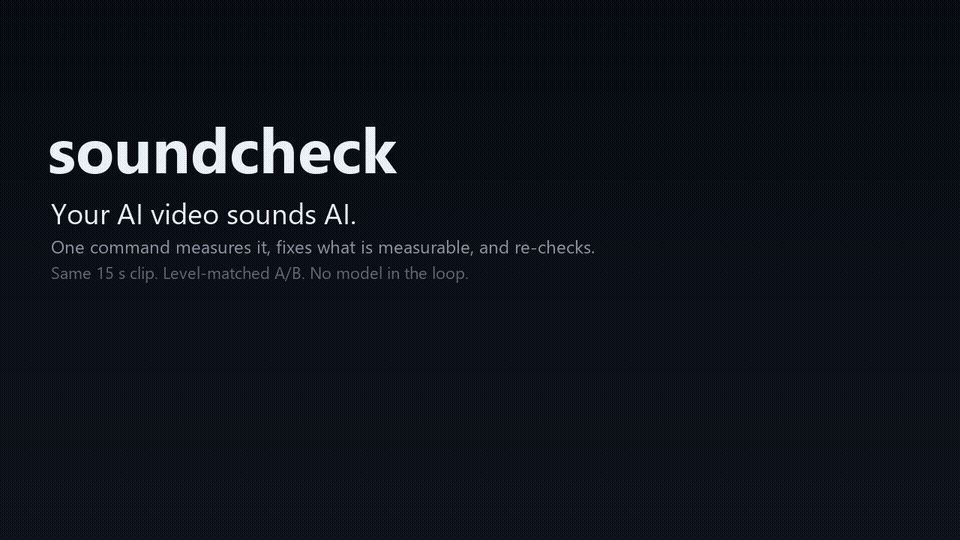

# soundcheck

English · **简体中文**

**你的 AI 视频，画面像样了，声音还带着 AI 味。**

`48/100 -> 100/100`，在随仓库附带的测试样本上测得，并用独立仪表复核。



[听有声版（25 秒 mp4）](https://github.com/user-attachments/assets/dfad655d-6312-4777-bcbf-6c460b0c4f09) —— 同一段素材，未处理 vs soundcheck，已做等响。

```bash
npx skills add liuchong110/soundcheck
python scripts/soundcheck.py fix clip.mp4 --target youtube   # 视频进，视频出
python scripts/soundcheck.py demo          # 不需要任何素材
python scripts/verify.py                   # 20/20 自测
```

## 问题

AI 视频的流水线把画面做明白了，声音还停在「能出声」：

- TTS 分段渲染，然后被**不同电平**硬拼在一起
- 音乐床**从不给人声让路**
- 为了「响」把总线顶进限幅器，**削波**
- 合成音色自带 **6–10 kHz 齿音**和 **100–300 Hz 浑浊**

这些不是审美问题。它们可测量，也可修复。

## 它做什么

```
$ python scripts/soundcheck.py demo

soundcheck - target youtube (streaming)
  duration 9.0s  48000 Hz  2 ch

  loudness         -6.9   target -14.0    FAIL
  true_peak         0.7   target -1.0     FAIL
  sibilance        0.72   target 0.45     FAIL
  mud              0.71   target 0.4      FAIL
  drift             2.7   target 3.0      ok
  noise_floor       n/a   target -45.0    ok    (no quiet passage)
  phase             1.0   target 0.2      ok

  SCORE 48/100 - sounds AI
```

```
$ python scripts/soundcheck.py fix demo_ai_voice.wav --target youtube
...
  loudness        -14.0   target -14.0    ok
  true_peak        -2.0   target -1.0     ok
  sibilance        0.14   target 0.45     ok
  mud              0.31   target 0.4      ok

  SCORE 100/100 - broadcast-ready
  verification: all measured tells within target
```

## 7 条 AI 音频破绽

| # | 破绽 | 目标 |
|---|---|---|
| 1 | 段与段之间的电平差 | ≤ 3 dB |
| 2 | 真峰值超顶 | ≤ -1 dBTP |
| 3 | 音乐不给人声让路 | 差距 ≥ 4 dB |
| 4 | 齿音过重 | ≤ 0.45 |
| 5 | 低中频浑浊 | ≤ 0.40 |
| 6 | 噪声底相对节目电平 | 低于节目 ≥ 45 dB |
| 7 | 相位 / 直流偏移 | 相关度 ≥ 0.2 |

## 响度阶梯

YouTube/TikTok/Reels -14 LUFS · Spotify -14 · Apple -16 · 播客 -16/-19 · EBU R128 -23 ·
国内短剧 -24 · 影院 -27。真峰值一律 ≤ -1 dBTP（影院 -2）。

## 工作原理

1. **测量** —— K 加权综合响度（BS.1770，按通道求和）、4 倍过采样真峰值、段间电平差、
   齿音与浑浊的频段能量比、噪声底相对节目电平、立体声相关度。
2. **修正** —— 减法 EQ 的深度由测量结果决定，不是预设。
   加 `--level` 时，每个说话段被对齐到各段电平的中位数（每段一个增益，30 ms 斜坡，±9 dB），
   逐句合成的配音不会再听起来是「拼」的。
3. **增益** —— 静态增益在**处理链输出上**计算，然后限幅到 -2 dBFS 采样峰值。
4. **复测** —— 结果会被重新测量；齿音或浑浊仍不达标，就从原始文件再走一遍更深的处理。
   只要还有指标超规，命令就以非零码退出。

没有模型参与。确定性、可审计，失败时它会说失败。

## 自己验证

三个层次，从最便宜到最有说服力。

**1. 跑自带自测（30 秒）。**

```bash
python scripts/verify.py
# 20/20 checks passed
```

覆盖：demo 确实是反面教材、我们的 LUFS/真峰值与 ffmpeg 一致、`fix` 只有在全部达标时才 exit 0、
**交付文件**用独立仪表复测、动态没有被压平、拼接段会被识别而等电平段和渐强不会误报，
以及静音、0.3 秒短片、单声道 24-bit、mp4、文件缺失这些边界情况。

**2. 手工对账。** 不要相信一个自己给自己打分的工具：

```bash
ffmpeg -hide_banner -nostats -i out.wav -filter_complex ebur128=peak=true -f null -
# Integrated loudness: I: -14.0 LUFS
# True peak:           Peak: -2.0 dBFS
```

我们的数字必须和 ffmpeg 一致（容差约 0.5 LU / 1 dB）。发布前正是靠这一步发现了 3.0 dB 的
立体声通道求和 bug。

**3. 用你自己的素材跑，并且人耳 A/B。** 这是唯一真正重要的测试：

```bash
python scripts/soundcheck.py analyze your_clip.mp4 --target youtube
python scripts/soundcheck.py fix     your_clip.mp4 --target youtube
```

然后听。达标只代表交付规格满足了，不代表混音好听。出现下面情况就该拒绝输出：

- 分数上去了，但人声发薄、发呲（EQ 过量）
- 音乐消失了（ducking 太深）
- 瞬态被压平（响度靠限幅器硬顶出来的）

工具允许说「还有 1 项没达标」。把非零退出码当成交付失败，而不是警告。

第 1 项比较的是「说话段」，所以音乐为主、硬切的片也可能触发。记分卡会打印跳变最大的时间点，
压平之前先去听。

## 它修不了什么

满分不等于像人。在仓库自带的短剧样本上，Windows SAPI 的音色和神经音色都能做到 -24.0 LKFS、
拿到 99–100 分，但只有一个听起来像人。差别在声源：

| | SAPI 2010，22 kHz | Edge 神经，24 kHz |
|---|---|---|
| 8 kHz 以上能量占比 | 0.005% | 1.231% |
| 源 LRA | 2.8 LU | 7.7 LU |

所以 `analyze` 会在高频几乎为空时打印带宽受限警告，`--naturalize` 存在但默认关闭：
**先换声源，再进母带。**

## 依赖

- Python 3.9+、numpy（scipy 可选，滤波更快）
- `fix`、非 WAV 输入、以及 `verify.py` 里的独立仪表都需要 PATH 上有 ffmpeg

## 路线图

- [x] 两遍修正循环（不达标就加深再修）
- [ ] 按题材的 stem-aware ducking 预设
- [ ] 频谱图 + 分数卡 PNG，用于 README / 社交
- [ ] 广播级 8 倍真峰值模式
- [ ] 短剧 / 漫剧的对话优先交付档

## 许可

MIT
